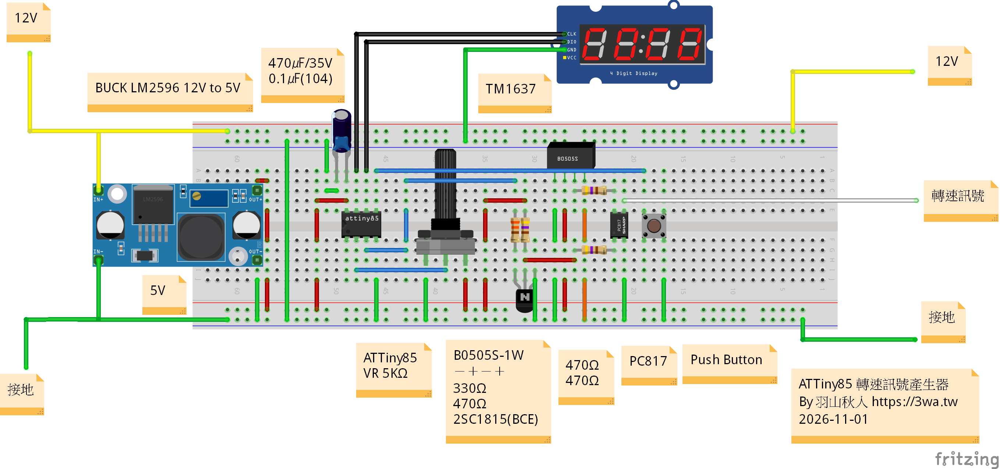

# ATtiny85 RPM Generator

此版本針對 VR 反應慢，以及轉動 VR、更新 TM1637 時接收端轉速先下降的問題修正。

`V1/115ATTiny85RPMGenerator/` 保留可變電阻控制版本；`V2/115ATTiny85RPMGenerator/` 增加 PB0 按鈕切換自動爬格子。Arduino IDE 請開啟對應資料夾內的同名 `.ino`。
## 電路圖

## 板子與接線

- ATtiny85，Internal 16 MHz（使用者已確認）。本次未讀取或寫入 fuse。
- V2 本次編譯使用本機 damellis `attiny:avr` 1.0.2、Arduino AVR core 1.8.8 與 TM1637 1.2.0；舊版驗證紀錄使用 core 1.8.6。
- FQBN：`attiny:avr:ATtinyX5:cpu=attiny85,clock=internal16`。
- PB2：TM1637 CLK；PB1：TM1637 DIO；PB3 / ADC3：VR；PB4：轉速輸出。
- 維持每轉一個週期、HIGH 330° / LOW 30°；0 RPM 立即停止並保持 LOW。

只確認了本機已安裝的核心與使用者指定的時鐘，未找到此專案之前燒錄所用的完整板子設定。不要將本機其他 sketch 的最近選項當作本專案的設定。

## V2 按鈕與自動爬格子

PB0 設為 `INPUT_PULLUP`，按鈕兩端接 **PB0 與 GND**（DIP-8 的 PB0 為第 5 腳）。放開為 HIGH、按下為 LOW，使用內部上拉即可。

開機預設使用原本的可變電阻。按下／放開都必須穩定 30 ms；每次有效按下只切換一次，長按不會連續切換。開機時已按住按鈕會維持可變電阻模式，必須放開後再按。

第一次按下後循環如下，所有數字均為實際 RPM：

1. 先輸出 0，停 2 秒；直接到 14000，再停 2 秒。
2. 13000、12000、11000……1000，每格 1 秒；降到 0，停 2 秒。
3. 1000、2000、3000……13000，每格 1 秒；升到 14000，停 2 秒。
4. 重複第 2、3 步。端點停留共 2 秒，不另加一格的 1 秒。

再按一次立即切回目前可變電阻的濾波讀值；下次進入自動模式會從 0 重新開始。自動模式仍持續取樣可變電阻，但不會影響階梯輸出。顯示維持固定 ×10 RPM（14000 RPM 顯示 1400）。

時間集中於 V2 的 `BUTTON_DEBOUNCE_MS`（30）、`AUTO_STEP_INTERVAL_MS`（1000）、`AUTO_ENDPOINT_HOLD_MS`（2000）。按鈕與階梯使用 `millis()` 非阻塞排程，原有 Timer1 脈波與 330° HIGH／30° LOW 比例維持不變。

## 修正設計

原始程式每 100 ms 取樣，加上 1/4 IIR，階躍約需 0.8 秒達到 90%。原本 PB4 依主迴圈的 `micros()` 輪詢，TM1637 傳輸阻塞主迴圈時無法產生脈波。

改用 Timer1 比較中斷排程 PB4，保留 Timer0 的 Arduino 計時。Timer1 使用系統時鐘 / 64，即每 tick 4 µs；長間隔分段計數，下一次比較以原定 deadline 為基準，避免將 ISR 執行時間累加進週期。每個排程間隔至少 64 ticks，避免短尾段錯過下一個比較。非零轉速更新以原子區塊交付成對的高低時間，直到下一個上升沿才套用，整個上升沿到上升沿週期使用同一組參數。停止可截短目前的 HIGH，重啟先等待完整 LOW。

完整週期交界更新會額外等待目前週期完成：500 RPM 時最多約 120 ms，14000 RPM 時約 4.3 ms。顯示值是目前要求的轉速，輸出在下一個週期起點跟上。

VR 每 10 ms 取樣，首筆直接初始化濾波器，之後使用 1/2 IIR；階梯邊界使用 4 ADC counts 滯回，維持既有 500 RPM 階梯。顯示傳輸期間中斷保持開啟。取樣仍可能被單次顯示傳輸延後，因此 10 ms 是目標間隔，不是硬性取樣期限。

程式專用 Timer1，請勿同時新增會佔用 Timer1 的 `tone()`、PWM 或其他計時器函式庫。切換到其他核心前應重新核對時基與 pin mapping。

## 四位顯示

使用者已同意全範圍固定 **×10 RPM**，預設 `DISPLAY_RPM_DIVISOR = 10`。**顯示值 × 10 = 實際要求的 RPM**；面板單位應標示為「×10 RPM」。例如：0→0、500→50、9500→950、10000→1000、10500→1050、14000→1400。

全範圍固定單位，不在 10000 門檻切換單位，也不再以 `HI` 代替範圍內轉速。除以 10 只用於顯示，PB4 輸出仍依原轉速產生 RPM / 60 Hz；500 RPM 顯示 50 時仍輸出約 8.333 Hz。既有階梯均可整除 10，沒有顯示精度損失。

## 驗證與實機檢查

可重跑的 host 測試位於 `tests/`，會使用實際 `.ino` 與寄存器／外設替身。這是理想時鐘下的排程驗證，不是實體示波器量測。

燒錄前仍需由使用者在 Arduino IDE 確認 ATtiny85 / Internal 16 MHz。實機驗收請量測 PB4 與接收端：

1. 0 RPM 維持 LOW；從 0 啟動、在 HIGH/LOW 各自停止，再重新啟動。
2. 500～14000 RPM 全階梯（500、1000、9500、10000、14000 特別檢查），輸出頻率應為 RPM / 60。
3. 快速往上與往下轉動 VR，確認顯示變更期間沒有漏沿造成的額外長週期。
4. VR 停在階梯邊界，觀察 ADC 雜訊是否需要調整滯回。
5. 確認 TM1637、PC817 與 B0505S 負參考電路的實際波形和接收端讀值。使用者已回報 B0505S 可驅動，但尚未驗收全轉速範圍。

內部振盪器誤差、ISR 延遲、光耦與接收電路都需以實機確認；本次不宣稱儀表已通過驗收。

參考：[Microchip ATtiny25/45/85 資料手冊，第 12 章](https://ww1.microchip.com/downloads/en/DeviceDoc/Atmel-2586-AVR-8-bit-Microcontroller-ATtiny25-ATtiny45-ATtiny85_Datasheet.pdf)、[avishorp TM1637](https://github.com/avishorp/TM1637)。

## V3 三模式測試器（2026-11-01）

Arduino IDE 開啟 `V3/115ATTiny85RPMGenerator/115ATTiny85RPMGenerator.ino`。接線與 V2 相同，PB0 按鈕接 GND；板子選 ATtiny85 / Internal 16 MHz。V1、V2 程式保留不變。

按鈕依序切換 **1 → 2 → 3 → 1**，每次顯示模式數字約 0.8 秒，再恢復轉速；顯示模式期間仍持續輸出訊號。

| 模式 | 行為 |
| --- | --- |
| 1 | 原本 VR 手動 **500 RPM 階梯**，0～14000，不改成 50 RPM。 |
| 2 | VR 平順控制：10-bit ADC 的 0～1023 共 1024 階，線性對應 0～14000 RPM，保留原有快速濾波。 |
| 3 | 原本自動爬格子：0 停 2 秒 → 14000 停 2 秒 → 13000、12000…0 → 1000…14000，反覆升降；中間每格 1 秒、兩端各 2 秒。 |

模式 2 在 ADC 0～8 保持 0 RPM、1015～1023 保持 14000 RPM，方便旋鈕確實歸零／到底；中間約每格 14 RPM，不再量化成 500 或 50 RPM。四位顯示仍是 ×10 RPM，小於 10 RPM 的尾數捨去，例如 7007 RPM 顯示 700，實際輸出仍按 7007 計算。顯示值代表要求值，並非頻率計實測值。

為了支援低於 500 RPM 的長週期，V3 的 Timer1 時間計數改為 32-bit。正常更新仍在週期交界套用完整 HIGH/LOW 參數；從低於 500 快轉到 500 RPM 以上時會停止舊週期並重啟，避免卡在數秒的低速脈波。因此該次過渡可能截短一個舊週期。0 RPM 立即停止並保持 LOW。

主機回歸可執行 `python3 tests/run_v3.py`，或 Windows 的 `& .\tests\run.ps1 -Version V3`。此版沒有替內部振盪器做頻率校正；先前示波器觀察到的約 3% 偏差仍應以實機量測為準。
